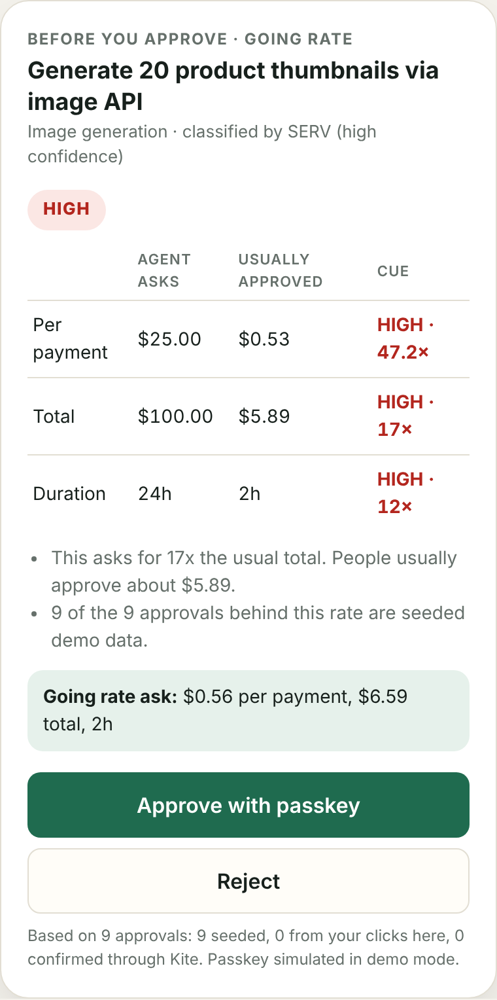
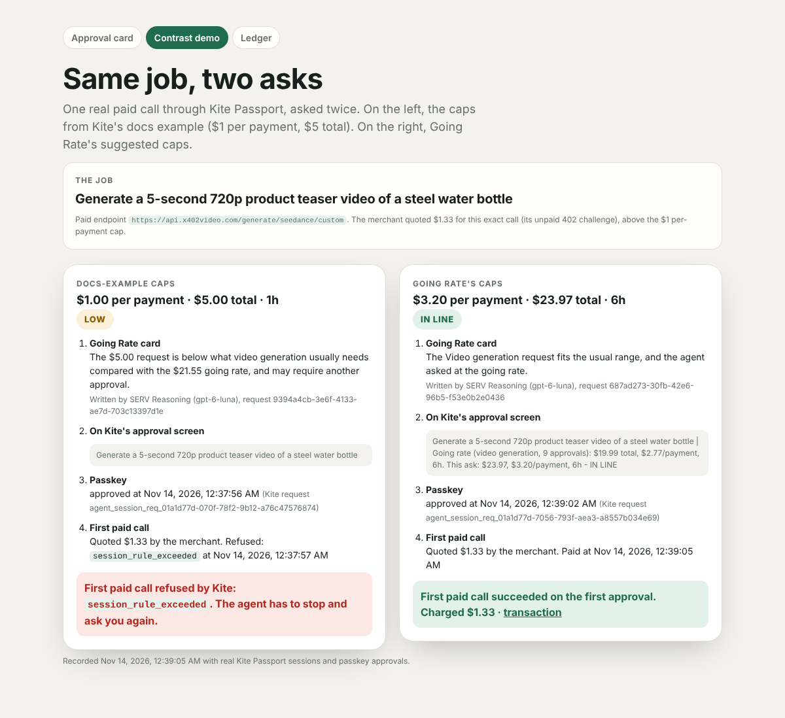

# Going Rate

**Built with: SERV Reasoning by OpenServ (inference API, `gpt-6-luna`) + Kite Passport (`kpass` sessions, passkey approvals, x402 payments).**
SERV Hackathon 02 · **Kite track**

**An agent should know the price of a job before it asks you to pay.**

Going Rate is a rate card for Kite Passport spending sessions. Before you tap your passkey, it tells you (and the agent) what people usually approve for that kind of task, so the agent asks for the right caps the first time. You approve once, and the run doesn't stop halfway for a second approval.

It's the going rate of the task, not an agent exam grade (Imprimatur), not one cart's total (PurseStrings).

**[Live demo](https://going-rate.ahmardchain.workers.dev/)** (no account needed) · **[Contrast demo](https://going-rate.ahmardchain.workers.dev/contrast)** · **[Ledger of real Kite payments](https://going-rate.ahmardchain.workers.dev/ledger)** · **[Demo video (70s)](https://x.com/Ahmardchain/status/2121415151375282467/video/1)** · [X post](https://x.com/Ahmardchain/status/2121415151375282467)

## Judges' checklist

| Requirement | ✓ | Where to check |
|---|---|---|
| **Uses SERV Reasoning** | ✓ | Two OpenServ inference calls per approval card: classify the task, then explain the card. Both SERV request IDs are shown on every card. Code: [`src/core/serv.js`](src/core/serv.js). Try it: [live demo](https://going-rate.ahmardchain.workers.dev/) → "Show approval card" |
| **Kite track: built on Kite Passport** | ✓ | `kpass session create --separate`, passkey approval, `kpass session status`, `kpass session execute`, `kpass activity` · [`src/kpass.js`](src/kpass.js) |
| **Real Kite payments, not mocks** | ✓ | [Ledger](https://going-rate.ahmardchain.workers.dev/ledger): paid calls across 5 task types through Kite Passport's production backend, settled in USDC on Base, each with a Basescan transaction link |
| **Public repo** | ✓ | This repo, MIT licensed |
| **Demo** | ✓ | [Live demo](https://going-rate.ahmardchain.workers.dev/) with no account needed · [Contrast](https://going-rate.ahmardchain.workers.dev/contrast) · [video](https://x.com/Ahmardchain/status/2121415151375282467/video/1) |
| **Short write-up** | ✓ | [`docs/SUBMISSION.md`](docs/SUBMISSION.md) |
| **Shared on X** | ✓ | [X post](https://x.com/Ahmardchain/status/2121415151375282467) |
| **Built during the hackathon** | ✓ | New project: all commits are dated 12–14 Nov 2026 (`git log`) |

| Judging criterion | Our answer |
|---|---|
| **Creativity** | A going rate for agent spending: SERV turns free-text tasks into stable categories, then code prices them from real approvals. It improves the first ask instead of adding another limiter |
| **User readiness** | Live on Cloudflare, usable without an account; an [agent API](#for-agent-builders-the-api) and CLI; 26 tests; tested against the real `kpass` 6.13.2 |
| **Revenue potential** | Paid going-rate lookups per session ask (an x402 listing in Kite's catalog), pooled benchmarks, first-ask analytics. See [Revenue](#revenue) |

<p align="center"></p>

## The problem: users guess caps, then get a second approval

When an agent needs to pay for something, it asks for a Kite session (`kpass session create`) with a per-payment cap, a total cap and a duration. You approve that with your passkey. Today, nobody knows what those caps should be, so they're guesses:

- **Too low:** Kite does exactly what it should and refuses the payment: `session_rule_exceeded` if one call costs more than the per-payment cap, `session_total_exceeded` when the run outgrows the total. The agent stops and asks you again. That's a second passkey prompt, in the middle of the job.
- **Too high:** you approve far more than the task needs, or you reject it and the agent asks again.

Kite's own docs example uses $1 per payment and $5 total. That's fine for a weather lookup. A 5-second 720p video is quoted at $1.33 by its merchant, so a $1 per-payment cap can't pay for it. The [contrast demo](https://going-rate.ahmardchain.workers.dev/contrast) ran that exact case on real Kite sessions on 14 Nov 2026: with the docs-example caps, Kite refused the first payment with `session_rule_exceeded`. With Going Rate's caps, the first passkey approval was enough and the video was paid on the first call.

Kite already records every approval and payment (`kpass activity`, `kpass user sessions`), but nothing turns that history into a better first ask. Going Rate does.

## What it does

```
agent drafts an ask ─► SERV classifies the task ─► code computes the going rate ─► card + Kite approval ─► outcome recorded
 (summary + caps)       (1 of 8 task types)         (p25 / median / p75)           (in line / high / low)     (rate updates)
```

1. **The agent drafts an ask:** a task summary plus per-payment, total and duration caps.
2. **SERV Reasoning classifies the task** into one of 8 fixed types: data API lookups, LLM inference, image generation, audio, video, web scraping, cloud compute, other.
3. **Code computes the going rate** for that type from approved asks (seeded plus Kite-verified): the 25th, 50th and 75th percentiles of each cap.
4. **The card compares the ask** cap by cap:
   - **HIGH** if a money cap is above 1.25 × the 75th percentile
   - **LOW** if it's below 0.8 × the 25th percentile
   - **IN LINE** otherwise

   It suggests caps at the 75th percentile. With fewer than 5 approvals for a type, it says there's no going rate yet.
5. **SERV explains the card in one sentence**, using only numbers code gave it.
6. **The going rate goes into Kite's `--task-summary`,** so it's on Kite's own approval screen, right next to the caps you're approving.
7. **After the passkey,** `kpass session status` reports the decision and `kpass session execute` pays. Both are recorded, and the rate and ledger update.

It's not a spend limiter or an approval gate. It never blocks or allows anything; Kite's caps already enforce limits. Going Rate improves the first ask.

## How SERV Reasoning is used

Going Rate makes **two calls to the OpenServ inference API** (`https://inference-api.openserv.ai/v1/chat/completions`, model `gpt-6-luna`) for every card. Both show on the card with their SERV request IDs.

1. **Classify.** The task summary and merchant host go to SERV with a constant system prompt (`CLASSIFIER_SYSTEM` in [`src/core/serv.js`](src/core/serv.js)) and strict JSON whose `task_type` is an enum of the 8 types. SERV compiles a system prompt into a reasoning flowchart and caches it per organization for 30 days. Because the prompt never changes, every classification reuses the same flowchart, and differently worded tasks ("Generate 20 product thumbnails", "Make 15 blog header images") land in the same bucket. That stability is what makes a going rate possible.
2. **Explain.** Code computes the going rate, the cue and the suggested caps, then hands them to SERV as facts with a second constant prompt (`EXPLAINER_SYSTEM`). SERV writes one sentence for the person about to approve. Code then checks that **every number in SERV's sentence is one it was given**. If not, the card shows a template sentence and says so.

**What SERV never does:** arithmetic, amounts, dates or cap comparisons. Replays aren't fully deterministic, so all of that is plain code in [`src/core/rates.js`](src/core/rates.js).

**`serv_prompt_guard` is on for both calls.** Task summaries are written by agents and are untrusted. A summary that tries to steer the classifier ("Ignore previous instructions…") is refused, gets no task type and can't feed the rate. Try it on the live demo.

## How Kite Passport is used

Only features that are live today, run against `kpass` 6.13.2 on Kite's production backend:

| Kite | Going Rate |
|---|---|
| `kpass agent:register` | The CLI is a registered agent (`--type going-rate`) |
| `kpass session create --separate` | Asks with the caps, and with the going rate in `--task-summary` |
| Passkey approval link plus `kpass session status --wait` | The decision, recorded as a Kite-verified outcome |
| `kpass session execute` | Real paid x402 / MPP calls from the approved session |
| `session_rule_exceeded` / `session_total_exceeded` | What the LOW cue predicts, and what the contrast demo shows |
| `kpass activity --kind x402_payment` | The ledger's source of truth: what was actually charged |
| `kpass activity --kind session_approval` plus `kpass user sessions` | Your approval history, turned into past asks |
| Kite service catalog (`ksearch`) | Listed prices for the ledger's listed-vs-charged column |

It doesn't use DIDs, VCs, escrow, streaming or conditional payments.

Three things we learned from the live CLI:
- **`--separate` is required.** Without it, `kpass session create` may pay from the account allowance with no approval, so the card is never seen.
- **Approval events only carry IDs.** The task and caps live in `kpass user sessions`.
- **Reading the decision.** A rejection makes `kpass session status` exit with code 3.

## Proof

- **[Ledger](https://going-rate.ahmardchain.workers.dev/ledger):** every real Kite Passport payment Going Rate made, read from `kpass activity --kind x402_payment`. Each row has the task type, the catalog's listed price against what Kite charged, the Basescan transaction and the time. It also lists every Kite-verified session decision. On 14 Nov 2026, real paid calls covered 5 task types:

  | Task type | Service | Listed | Charged |
  |---|---|---|---|
  | Data API lookups | Exa search | $0.007 | $0.007 |
  | LLM inference | GEDX402 Chat | $0.005 | $0.002 |
  | Image generation | StableStudio Nano Banana | $0.039 | $0.07 |
  | Web scraping | Exa contents | $0.001 | $0.001 |
  | Video generation | x402 Video Gateway (Seedance, 5s 720p) | $0.98 | $1.33 |

  Listed prices aren't what a job costs: the video cost 36% more than listed, and the image nearly 80% more. That's why Going Rate learns from what people approve and what Kite charges, not from catalog prices alone.
- **[Contrast demo](https://going-rate.ahmardchain.workers.dev/contrast):** one real job asked twice on Kite: a 5-second 720p video, quoted at $1.33.

  | | Docs-example caps | Going Rate's caps |
  |---|---|---|
  | Caps | $1 per payment, $5 total, 1h | $3.20 per payment, $23.97 total, 6h |
  | Card | **LOW** | **IN LINE** |
  | Passkey | approved | approved |
  | First paid call | **refused: `session_rule_exceeded`** | **paid, $1.33** |

  With the docs-example caps, the agent would have to stop and ask you again. Both columns show SERV's sentence, the text Kite's approval screen showed, and the Kite request IDs.

  
- **Going rate on Kite's approval screen:** each session's `--task-summary` carried the going rate, for example "… \| Going rate (image generation, 11 approvals): $5.89 total, $0.53/payment, 2h. This ask: $6.56, $0.56/payment, 2h - IN LINE".
- **Live run, 12 Nov 2026:** a $100 / $25-per-payment ask for image generation got a HIGH card and was rejected with a passkey. A similar task asked at the going rate got IN LINE and was approved. Both decisions are on the ledger.
- **What went wrong, honestly:**
  - Two merchants (fal.ai and Firecrawl) settle over MPP on Tempo, which Kite Passport couldn't pay ("unsupported merchant asset/network combination"). Both were refused before payment and replaced with Base x402 merchants.
  - One $0.01 weather payment is still `payment_outcome_pending` on Kite's side. It's shown as not settled and isn't counted.
  - One session was classified "Other" by an earlier version that classified twice per ask; that bug is fixed.

## Built during the hackathon (12–15 Nov 2026)

Going Rate is a new project; all of it was built for SERV Hackathon 02:
- the rate engine (percentiles, cues, suggested caps) and its tests
- the SERV classifier and explainer, with the prompt guard and the number check
- the Kite integration: `ask`, `record`, `sync`, `pay`, `quote`, `ledger` and `contrast` over the live `kpass` and `ksearch` CLIs
- the going rate inside Kite's `--task-summary`
- the Cloudflare Worker, the approval-card demo, the ledger and the contrast page
- 26 tests, including fixtures built from real `kpass` output

## What's real and what's seeded

| | Status |
|---|---|
| SERV classification and explanation | Real, live API calls, on the hosted demo and in the CLI |
| Kite sessions, passkey decisions and payments | Real, via `kpass` on Kite's production backend (see the ledger) |
| Listed prices | Kite's service catalog. The contrast demo also uses the merchant's own 402 quote for the exact call |
| Passkey on the main demo page | **Simulated**. Clicks are stored as demo outcomes, scoped to your browser. The contrast demo and ledger are real |
| Starting pool | **Seeded**: 93 records in [`data/seed-pool.json`](data/seed-pool.json), all marked `seeded: true`. Every card says how many of its approvals are seeded. Kite-verified decisions are in [`data/verified-pool.json`](data/verified-pool.json) |

`kpass activity` only covers one account, so no shared pool of real approvals exists yet. Going Rate is built to start one.

## For agent builders: the API

Call it before `kpass session create`:

| Endpoint | Body | Returns |
|---|---|---|
| `POST /api/suggest` | `{ task_summary, payment_context? }` | task type and suggested caps |
| `POST /api/check` | `{ task_summary, payment_context?, per_tx_usd, total_usd, ttl_hours }` | the card: going rate, cue, SERV explanation, `kite_task_summary`, SERV request IDs |
| `POST /api/outcome` | `{ check_id, outcome, kite_request_id? }` | the recorded outcome |
| `GET /api/rates` · `GET /api/verified` · `GET /ledger.json` | | rates by task type, Kite-verified decisions, real payments |

```bash
curl -s https://going-rate.ahmardchain.workers.dev/api/suggest \
  -H 'content-type: application/json' \
  -d '{"task_summary":"Transcribe 6 meeting recordings"}'
```

## Revenue

- **Going-rate lookups as a paid service** for agent frameworks and wallets, called before each session ask. The natural channel is an x402 service in Kite's own catalog. This is planned, not built.
- **Data that compounds:** each verified decision and payment sharpens the rates, so contributors can get free lookups in exchange for their outcomes.
- **First-ask analytics** for agent marketplaces: which agents ask for sensible caps, and how often they get approved the first time.

## Limitations

- The pool is still mostly seeded. Rates sharpen as verified outcomes come in.
- The 8 task types are coarse. A small and a large job of one type share a rate.
- Rates compare approved caps. Real charged prices are on the ledger but don't drive the cue yet.
- The hosted pool is a single KV key, which is fine for a demo but not at scale.

## Run it

Needs Node 22 or newer. The app has no runtime dependencies; `npm install` only adds wrangler.

```bash
npm install
npm test                          # 26 tests
```

```bash
SERV_API_KEY=... npm run dev      # http://localhost:8787
```

Agent CLI. Every command except `check` needs [`kpass`](https://docs.gokite.ai/passport/install): install it, log in, and run `kpass agent:register --type going-rate`.

```bash
# Card only
SERV_API_KEY=... node src/cli.js check --summary "Generate 20 product thumbnails" --per-tx 25 --total 100 --ttl 24h

# Ask at the going rate: card, Kite session with the going rate in --task-summary, passkey, outcome recorded
SERV_API_KEY=... node src/cli.js ask --summary "Make 15 blog header images"

# One real paid call from the approved session, noted for the ledger
SERV_API_KEY=... node src/cli.js pay --summary "Current weather in Lisbon" --method GET --url "https://weather.hugen.tokyo/weather/current?city=Lisbon"

# Free: the merchant's 402 quote and the catalog's listed price for one exact call
SERV_API_KEY=... node src/cli.js quote --url https://api.x402video.com/generate/seedance/custom --body '{"prompt":"...","duration":5,"resolution":"720p"}'

# The contrast run: docs-example caps vs going-rate caps, same call
SERV_API_KEY=... node src/cli.js contrast --summary "5-second 720p product teaser video" --url https://api.x402video.com/generate/seedance/custom --body '{...}'

# Rebuild public/ledger.json and data/verified-pool.json from Kite
SERV_API_KEY=... node src/cli.js ledger
```

`sync` (your past approvals) and `record` (a decision for an existing request) are also available. Behind an HTTPS proxy, add `NODE_USE_ENV_PROXY=1`.

## Deploy (Cloudflare Workers)

```bash
npx wrangler deploy                     # creates the GOING_RATE KV namespace on first deploy
npx wrangler secret put SERV_API_KEY
```

With Cloudflare's Git integration, every push deploys.

## Layout

```
src/core/taxonomy.js  the 8 task types
src/core/serv.js      SERV classifier and explainer: constant prompts, strict JSON, prompt guard, number check
src/core/rates.js     going rate, cues, suggested caps, Kite task summary (plain code)
src/core/ledger.js    ledger rows from Kite payment events, explorer links, per-type prices
src/app.js            HTTP API shared by the Worker and the dev server
src/worker.js         Cloudflare Worker
src/kpass.js          kpass: session create/status/execute, activity, user sessions
src/catalog.js        ksearch listed prices and free 402 quotes
src/cli.js            going-rate check | ask | pay | quote | contrast | ledger | sync | record
public/               approval card, /contrast, /ledger, ledger.json, contrast.json
data/                 seeded pool, Kite-verified decisions, payment notes
test/                 26 tests
docs/                 submission write-up, video script, screenshot
```

## Credits

The demo video was recorded from the live site with Playwright and edited with ffmpeg ([`docs/video/`](docs/video/)). The voiceover is [Piper](https://github.com/rhasspy/piper) (open-source, run locally) with the `en_US-ryan-high` voice.

The Animated Beam, Border Beam, Number Ticker and Shimmer Button effects are vanilla JS/CSS ports of [Magic UI](https://magicui.design) components (also published on [21st.dev](https://21st.dev)), MIT License, Copyright (c) Magic UI. See [`public/ui.js`](public/ui.js) and the end of [`public/style.css`](public/style.css).

## License

MIT
